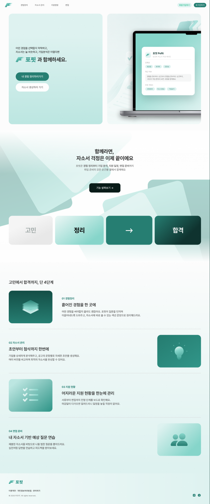
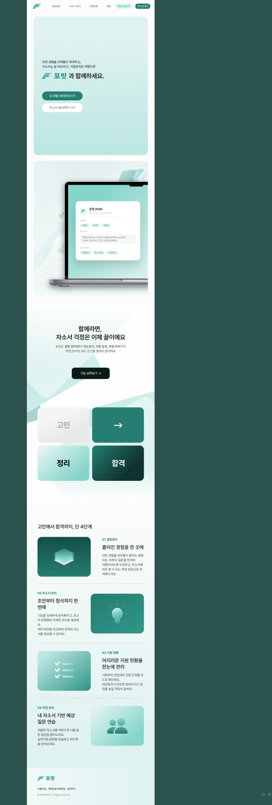

# 02. 홈(랜딩) 화면 구현 및 고도화 계획

상태: **원격 main에 기본 구현 존재**. 새로운 구현 전 Figma 원본과 현재 코드를 시각·인터랙션 비교합니다.

## Figma 디자인
- [홈 1440px](https://www.figma.com/design/0wZM1igoWTo0vJt4Ncqpgl/Pofit-%ED%8F%AC%ED%95%8F?node-id=1-48305) / [1024px](https://www.figma.com/design/0wZM1igoWTo0vJt4Ncqpgl/Pofit-%ED%8F%AC%ED%95%8F?node-id=1-48399)
- [홈 1023px](https://www.figma.com/design/0wZM1igoWTo0vJt4Ncqpgl/Pofit-%ED%8F%AC%ED%95%8F?node-id=1-54906) / [720px](https://www.figma.com/design/0wZM1igoWTo0vJt4Ncqpgl/Pofit-%ED%8F%AC%ED%95%8F?node-id=1-55000)
- [홈 섹션 전체](https://www.figma.com/design/0wZM1igoWTo0vJt4Ncqpgl/Pofit-%ED%8F%AC%ED%95%8F?node-id=1-48304)

| 1440 시안 | 720 시안 |
| --- | --- |
|  |  |

> 세로가 긴 원본 프레임을 1500px까지 축소한 미리보기. 원본 사이즈와 자세한 애니메이션은 Figma 링크로 확인합니다.

## 현재 코드 현황 (2026-11-01)
| 코드 | 역할 | 검증해야 할 점 |
| --- | --- | --- |
| `src/app/page.tsx` | Header → Hero → IntroStory → Steps → Footer | 페이지 섹션 순서·의미 구조 |
| `src/components/Header.tsx` | 스티키 메뉴, 가입·로그인 CTA | 경험·신규 자소서·지원·로그인은 연결됨; **가입도 `/login`으로 연결된 상태**, 로고/면접은 `#` |
| `src/components/sections/Hero.tsx` | 슬로건, 주요 CTA, 기기 목업 | 1440 이하 고정 크기·폭 |
| `src/components/sections/IntroStory.tsx` | 소개, 고민→정리→합격 전환 | 모바일 텍스트 줄바꿈 |
| `src/components/sections/Steps.tsx` | 경험/자소서/지원/면접 4단계 | 인터랙션·네비게이션 |
| `src/components/Reveal.tsx` | Motion 기반 scroll-reveal | `viewport.once: true` |
| `src/components/Footer.tsx` | 브랜드/정책/소셜 영역 | 정책·링크 대상 미확정 |
| `public/figma` | 로고, 히어로, 배경, 단계별 SVG/PNG | 누락·aspect ratio 점검 |

## 구현할 화면 구성
1. Header: 로고, 경험 정리·자소서 관리·지원 현황·면접 네비게이션, 로그인/회원가입 버튼.
2. Hero: 서비스 가치 전달 카피, 경험 정리 / 자소서 생성 CTA, 그래픽과 MacBook 목업 애니메이션.
3. IntroStory: 사용자 고민 → 해결 → 합격 경험 흐름, 서비스 소개, `#steps` 이동 버튼.
4. Steps: 경험 정리 → 자소서 관리 → 지원 현황 → 면접 준비에 대한 단계별 설명.
5. Footer: 로고, 이용약관·개인정보처리방침·문의하기, 소셜 아이콘.

## 인터랙션 및 라우팅 정의 (제안)
| 시작 요소 | 동작 | 사전조건/상태 |
| --- | --- | --- |
| 로고 | `/`로 이동 | 항상 허용 |
| 경험 정리 네비·Hero CTA | `/experiences` | 로그인 필요시 인증 페이지로 복귀 경로 전달 |
| 자소서 네비·Hero CTA | `/cover-letters` | 동일 |
| 지원 현황 네비 | `/applications` | 동일 |
| 로그인·가입 버튼 | `/login`, `/signup` | 실제 라우트 구현 이후 연결 |
| 기능 살펴보기 | `#steps`로 스크롤 | sticky header에 가리지 않도록 offset |
| 푸터 약관/정책/문의 | 확정된 실제 URL | 페이지/연락처 협의 전 placeholder 명시 |
| 면접 메뉴 | 별도 범위 협의 | 미구현 라우트로 방치하거나 오인 유도 금지 |

## 디자인·애니메이션 구현 포인트
- `Hero`의 floating 리포트 카드와 디바이스 진입 모션이 Figma 프레임과 일치하는지 검증.
- 기존 `Reveal`의 once 동작과 Figma 메모의 재진입 시 재생 요구가 다릅니다. 재진입 replay 구현 여부를 UX 팀과 확정.
- 1440 → 1024 → 1023 → 720에서 헤더 메뉴, Hero 2열, 리포트 목업, 긴 텍스트의 overflow 검토.
- `prefers-reduced-motion`에 따라 opacity/transform 애니메이션 줄이거나 정적 표시.
- 홈 그림은 모두 `public/figma` 원본을 사용하되 과도한 중복 렌더·화질 저하·누락을 피함.
- SEO: title/description, heading 1개, 링크 설명, LCP 대상 이미지 최적화 검토.
- 정적 이미지를 장식으로 쓰는 경우만 `alt=""`, 의미 전달 이미지에는 설명 제공.
- 모바일에서 포인터 호버에 의존하지 않는 네비게이션 구조 적용.

## 구현 순서
- [ ] Figma 1440/1024/1023/720 vs 로컬 캡처 스크린샷 1차 비교
- [ ] `public/figma`의 모든 이미지 경로·파일 유효성 검증
- [ ] Hero/IntroStory/Steps 시각 누락·여백·폭·폰트 수정
- [ ] 공통 헤더를 `Link` 기반 실제 경로로 전환 (목적지 화면은 순차 구현)
- [ ] 모바일/컴팩트 navigation, 이미지 최소 폭·스크롤 누수 수정
- [ ] 스크롤 모션의 replay / once 정책 검토 및 구현
- [ ] reduced motion / keyboard / focus / skip link / aria-label 보완
- [ ] 정책·소셜·면접 링크 확정, 미구현 기능에 명확한 안내
- [ ] 1440/1024/1023/720/360 시각 회귀 및 Lighthouse 검사

## 수용 테스트
| ID | 시나리오 | 기대 결과 |
| --- | --- | --- |
| HOME-01 | 첫 방문 | hero와 이미지가 빠짐없이 표시, 콘솔 에러 없음 |
| HOME-02 | 로그인/가입 클릭 | 해당 경로 이동, 404 또는 `#` 정체 없음 |
| HOME-03 | 경험/자소서 CTA 클릭 | 의도한 진입 화면 이동/인증 필요 시 반환 경로 유지 |
| HOME-04 | 1024/1023/720/360로 변경 | 레이아웃 잘림·가로 스크롤·버튼 겹침 없음 |
| HOME-05 | 섹션 진입·복귀 | UX 확정된 방식으로 애니메이션 반복/유지 |
| HOME-06 | reduced motion 사용 | 과한 진입 애니메이션 없이 모든 콘텐츠 노출 |
| HOME-07 | 키보드 탐색 | 보이는 순서대로 포커스, 모든 링크 활성화 가능 |

## 완료 기준
- [ ] 원격 홈 구현을 보존하면서 디자인·동작 차이 해소.
- [ ] 주요 버튼이 실제 목적지/명시적인 미구현 안내로 연결.
- [ ] 모든 반응형 뷰포트의 캡처 비교 완료.
- [ ] Figma 원본 이미지를 정확한 위치·비율로 렌더링.
- [ ] ESLint/TypeScript/빌드 통과.

## 선행 조건/미확정
- 공통 Button/Header의 인증 상태별 노출 정책.
- 면접 기능 라우트·MVP 포함 여부.
- 스크롤 재진입 모션 UX 요구(once vs repeat).
