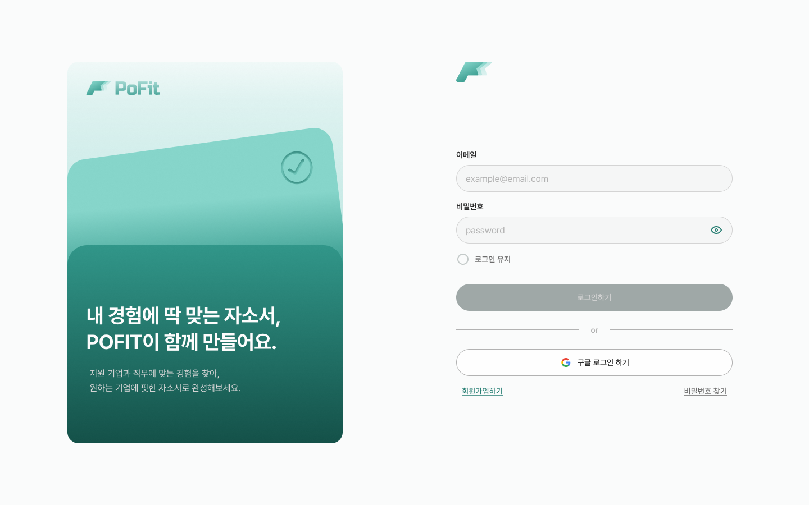
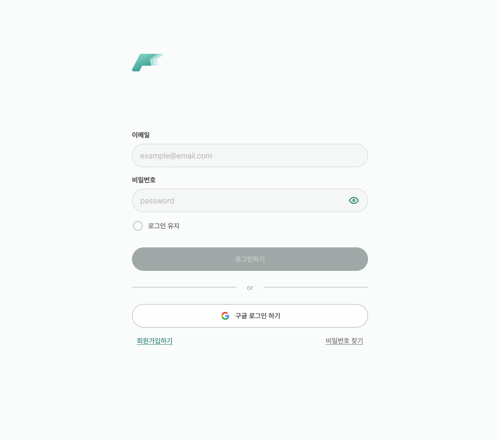
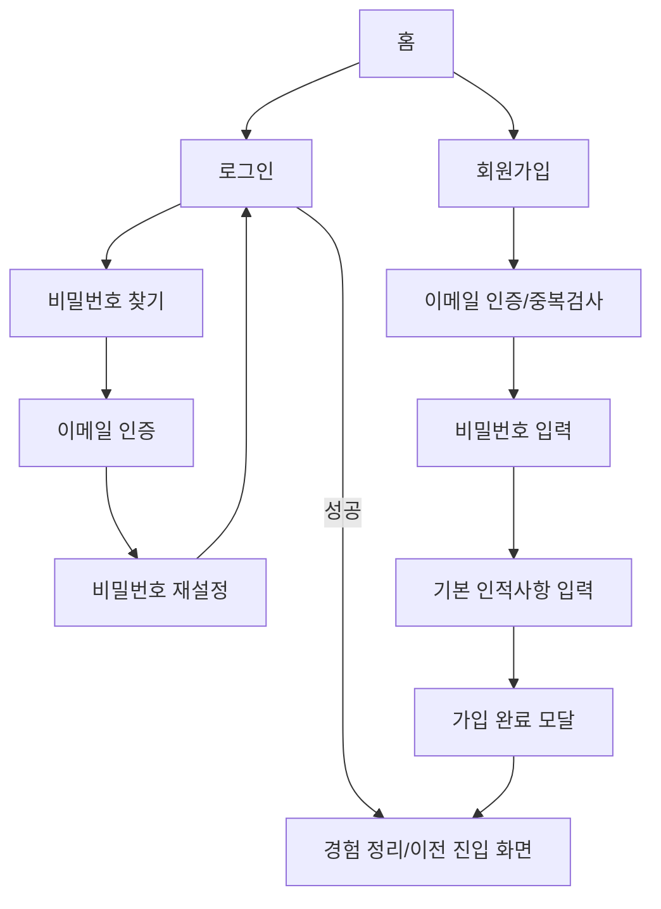

# 03. 로그인 / 회원가입 / 비밀번호 찾기 구현 계획

상태: **부분 구현**. `/login` 시각 화면과 `/find-password`의 이메일 인증 1단계 UI가 존재합니다. **실제 로그인/Google OAuth, 코드 검증, 회원가입 및 비밀번호 재설정은 미구현**입니다.

### 현재 구현된 로그인 화면 (원격 `0402e76` 기준)
- `src/app/login/page.tsx`: 데스크톱 카드+입력폼 2열 배치, SEO metadata.
- `src/components/login/LoginCard.tsx`, `LoginForm.tsx`: 로고, 이메일/PW, eye 토글, 로그인 유지, 구글 로그인 버튼, 가입/비밀번호 찾기 링크.
- `showPw`와 `keepLogin`은 React 로컬 상태로 동작합니다. `<form onSubmit={(e)=>e.preventDefault()}>`이므로 **실제 인증이나 서버 검증은 이루어지지 않습니다.**
- 회원가입 링크는 현재 `href="#"`이고 비밀번호 찾기는 `/find-password`로 이동합니다. 홈 헤더의 회원가입 버튼도 아직 `/login`으로 이동하므로 다음 작업에서 수정해야 합니다.
- 새로 추가된 에셋: `public/figma/login-card.svg`, `login-logo.svg`, `icon-eye.svg`, `icon-google.svg` 등.
- `src/app/find-password/page.tsx` + `src/components/login/FindPasswordForm.tsx`: 이메일/6자리 인증코드 입력·발송/인증 버튼·단계 표시의 **정적 UI**가 추가되었습니다. 인증 요청·코드 검증·다음 단계로 넘어가기 동작은 아직 없습니다.
- 선행 작업: 폼 검증/제출 상태 → 인증 API/세션 → 회원가입/실제 비밀번호 재설정 → 화면별 Figma 오류/반응형 검증.

## Figma 화면과 캡처
- [데스크톱 인증 섹션](https://www.figma.com/design/0wZM1igoWTo0vJt4Ncqpgl/Pofit-%ED%8F%AC%ED%95%8F?node-id=1-48162)
- [컴팩트 인증 섹션](https://www.figma.com/design/0wZM1igoWTo0vJt4Ncqpgl/Pofit-%ED%8F%AC%ED%95%8F?node-id=1-54745)

| 1440 로그인 | 1023 로그인 |
| --- | --- |
|  |  |

### 실제 화면 노드
| 기능/상태 | Desktop Figma 링크 | Compact Figma 링크 |
| --- | --- | --- |
| 로그인 기본 | [`1:48173`](https://www.figma.com/design/0wZM1igoWTo0vJt4Ncqpgl/Pofit-%ED%8F%AC%ED%95%8F?node-id=1-48173) | [`1:54756`](https://www.figma.com/design/0wZM1igoWTo0vJt4Ncqpgl/Pofit-%ED%8F%AC%ED%95%8F?node-id=1-54756) |
| 비밀번호 표시 on/off | [`1:48284`](https://www.figma.com/design/0wZM1igoWTo0vJt4Ncqpgl/Pofit-%ED%8F%AC%ED%95%8F?node-id=1-48284) / [`1:48287`](https://www.figma.com/design/0wZM1igoWTo0vJt4Ncqpgl/Pofit-%ED%8F%AC%ED%95%8F?node-id=1-48287) | 동일 플로우 |
| 로그인 유지 | [`1:48290`](https://www.figma.com/design/0wZM1igoWTo0vJt4Ncqpgl/Pofit-%ED%8F%AC%ED%95%8F?node-id=1-48290) | 동일 플로우 |
| 회원가입 시작 | [`1:48179`](https://www.figma.com/design/0wZM1igoWTo0vJt4Ncqpgl/Pofit-%ED%8F%AC%ED%95%8F?node-id=1-48179) | [`1:54762`](https://www.figma.com/design/0wZM1igoWTo0vJt4Ncqpgl/Pofit-%ED%8F%AC%ED%95%8F?node-id=1-54762) |
| 이메일 인증 / 미가입 | [`1:48182`](https://www.figma.com/design/0wZM1igoWTo0vJt4Ncqpgl/Pofit-%ED%8F%AC%ED%95%8F?node-id=1-48182) / [`1:48188`](https://www.figma.com/design/0wZM1igoWTo0vJt4Ncqpgl/Pofit-%ED%8F%AC%ED%95%8F?node-id=1-48188) | [`1:54765`](https://www.figma.com/design/0wZM1igoWTo0vJt4Ncqpgl/Pofit-%ED%8F%AC%ED%95%8F?node-id=1-54765) |
| 인증 재발송 / 성공 | [`1:48191`](https://www.figma.com/design/0wZM1igoWTo0vJt4Ncqpgl/Pofit-%ED%8F%AC%ED%95%8F?node-id=1-48191) / [`1:48200`](https://www.figma.com/design/0wZM1igoWTo0vJt4Ncqpgl/Pofit-%ED%8F%AC%ED%95%8F?node-id=1-48200) | [`1:54774`](https://www.figma.com/design/0wZM1igoWTo0vJt4Ncqpgl/Pofit-%ED%8F%AC%ED%95%8F?node-id=1-54774) |
| 비밀번호 재설정 / 요건 오류 | [`1:48203`](https://www.figma.com/design/0wZM1igoWTo0vJt4Ncqpgl/Pofit-%ED%8F%AC%ED%95%8F?node-id=1-48203) / [`1:48209`](https://www.figma.com/design/0wZM1igoWTo0vJt4Ncqpgl/Pofit-%ED%8F%AC%ED%95%8F?node-id=1-48209) | [`1:54786`](https://www.figma.com/design/0wZM1igoWTo0vJt4Ncqpgl/Pofit-%ED%8F%AC%ED%95%8F?node-id=1-54786) |
| 비밀번호 중복 / 불일치 | [`1:48212`](https://www.figma.com/design/0wZM1igoWTo0vJt4Ncqpgl/Pofit-%ED%8F%AC%ED%95%8F?node-id=1-48212) / [`1:48218`](https://www.figma.com/design/0wZM1igoWTo0vJt4Ncqpgl/Pofit-%ED%8F%AC%ED%95%8F?node-id=1-48218) | 동일 플로우 |
| 기본 인적사항 / 희망 직군 | [`1:48254`](https://www.figma.com/design/0wZM1igoWTo0vJt4Ncqpgl/Pofit-%ED%8F%AC%ED%95%8F?node-id=1-48254) / [`1:48260`](https://www.figma.com/design/0wZM1igoWTo0vJt4Ncqpgl/Pofit-%ED%8F%AC%ED%95%8F?node-id=1-48260) | 동일 플로우 |
| 가입 완료 | [`1:48266`](https://www.figma.com/design/0wZM1igoWTo0vJt4Ncqpgl/Pofit-%ED%8F%AC%ED%95%8F?node-id=1-48266) | 동일 플로우 |

## 목표 URL 및 컴포넌트
- `/login`: `LoginForm`, `PasswordField`, `RememberMe`, `SocialLoginButton`.
- `/signup`: `SignUpWizard`, `EmailVerification`, `PasswordSetup`, `ProfileForm`, `CompletionDialog`.
- `/find-password` (**현재 생성된 경로**): `VerifyEmail` → `ResetPassword` → `ResetSuccess`를 순차 구현. 기존 `/forgot-password` 계획 경로와 혼용하지 말고 최종 URL 정책을 합의.
- `(auth)/layout.tsx`: 데스크톱 브랜드 비주얼 + 오른쪽 폼, 컴팩트에서 여백/컬럼 재배치.
- `src/features/auth/*`: 단계/검증/서버 요청·세션 처리; 실제 인증 API 확정 전 mock adapter.

## 사용자 플로우와 상태

| 화면 | 트리거 | UI 상태 | 오류/예외 대응 |
| --- | --- | --- | --- |
| 로그인 | 이메일·PW 입력 | untouched, editing, ready, submitting | 형식/빈 값/계정 오류/서버 장애 |
| 암호 보기 | eye 클릭 | visible / hidden | 입력/포커스 유지 |
| 로그인 유지 | 토글 클릭 | on / off | 세션 지속기간은 서버 정책 확인 |
| 이메일 인증 | 메일 발송 → 코드 입력 | sending, sent, verifying, verified | 중복, 불일치, 만료, 재발송 제한 |
| 비밀번호 생성 | PW/확인 입력 | 요구 조건 충족/불충족 | 두 입력 불일치, 기존 PW 재사용 |
| 프로필 | 기본사항 입력 | 선택 가능 항목, 직군 다중선택 | 필수 항목 누락 |
| 회원가입 완료 | 가입 요청 성공 | 모달 열림 | 중복 요청 차단 |
| 비밀번호 찾기 | 미가입 이메일 입력 | inline error | 계정 존재 노출 정책 서버 협의 |

## 유효성/보안 규약 (팀 결정 필요)
- 형식: 이메일 공백·대소문자·표시 메시지; 비밀번호 **정확한 정책은 백엔드와 일치**시켜야 함.
- 유효성 검사는 프론트 편의 기능이며 서버에서 반드시 재검증. 서버 에러코드를 필드/폼 에러로 변환.
- 인증코드 만료시간, 재발송 쿨다운, 시도 횟수는 API 규칙을 기준으로 표시. 프론트에서 임의로 보안 로직을 확정하지 않음.
- OAuth는 PKCE/redirect/CSRF 정책 확인 후 구현. 비밀번호/OTP를 localStorage·로그에 기록하지 않음.
- 로그인 보호 라우트에서는 인증 이전 사용자가 요청한 복귀 주소를 안전하게 검증하여 보존.
- 등록/로그인 오류는 계정 존재 여부 유출 가능성이 있으므로 API 보안 정책 우선 적용.

## API 계약 초안 (제안이며 실제 엔드포인트 아님)
| 목적 | 제안 인터페이스 | 클라이언트 결과 |
| --- | --- | --- |
| 이메일 인증 시작 | `requestEmailVerification(email, purpose)` | 발송/재시도/제한 표시 |
| 코드 확인 | `verifyEmailCode(email, code)` | 다음 단계 활성화 |
| 회원가입 | `signUp({email,password,profile,...})` | 완료·세션 처리 |
| 로그인/로그아웃 | `signIn({email,password,remember})` / `signOut()` | 전역 사용자 갱신 |
| 비밀번호 재설정 | `resetPassword(verificationToken,password)` | 성공/만료 처리 |
| 프로필 조회 | `getMe()` | 헤더/보호 영역 렌더 |

## 구현 순서
- [ ] Figma desktop/compact 기본 화면 및 오류 상태 정확한 스크린샷 대조
- [ ] 공통 AuthShell 및 EmailField/PasswordField/OTP UI
- [ ] `/login` 입력 검증·암호보기·로그인 유지·에러 표시·이중 제출 방지
- [ ] `/signup` 이메일 → 인증 → 비밀번호 → 인적사항 단계 관리
- [ ] `/forgot-password` 인증 → 재설정 및 실패·성공 상태
- [ ] 스텝 간 뒤로가기, 입력 보존, 브라우저 새로고침 정책 결정
- [ ] mock service를 통한 happy path/오류/재시도 테스트
- [ ] API 계약 확정 후 서버 세션·OAuth 연결, 보안 검증
- [ ] 1440/1023/720/360 뷰포트, 키보드, 스크린리더 점검

## 테스트 및 완료 기준
- [ ] AUTH-01: 필수값이 없거나 형식이 틀리면 제출 차단, 필드별 오류가 보임.
- [ ] AUTH-02: password eye 클릭 시 텍스트만 토글되고 값·포커스는 유지됨.
- [ ] AUTH-03: 검증 이메일이 잘못되었거나 만료되면 재시도가 가능함.
- [ ] AUTH-04: 가입 실패 뒤 정상 입력이 사라지지 않고 중복 제출 없음.
- [ ] AUTH-05: 로그인 성공 시 원래 보호 페이지로 안전하게 복귀.
- [ ] AUTH-06: 1023/720에서 폼이 잘리거나 키보드 입력을 가리지 않음.
- [ ] AUTH-07: 탭 이동, Enter, aria-invalid, error association 및 눈 버튼 이름 정상.
- [ ] AUTH-08: mock-only와 실제 API 연결 완료 상태를 혼동 없이 표기.

## 미확정 사항
- 세션/쿠키, 구글 OAuth, 프로필 필수 입력, PW 규칙, 이메일 코드 정책.
- 이메일 계정 존재 노출 여부와 통일된 에러 메시지 정책.
