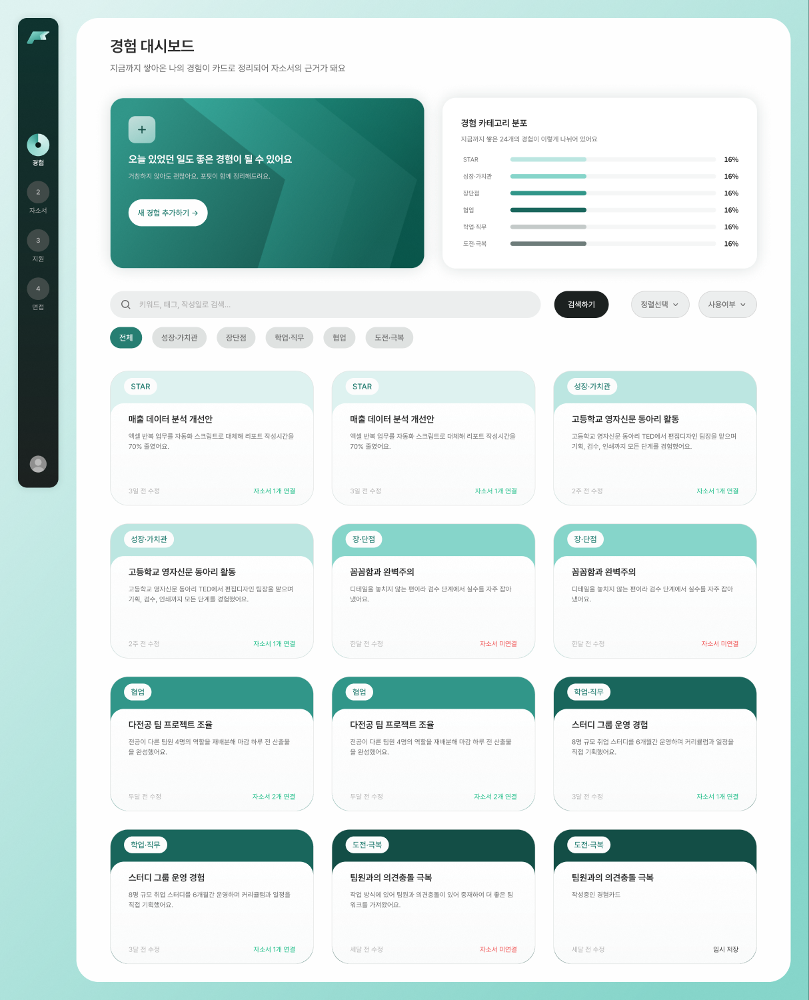
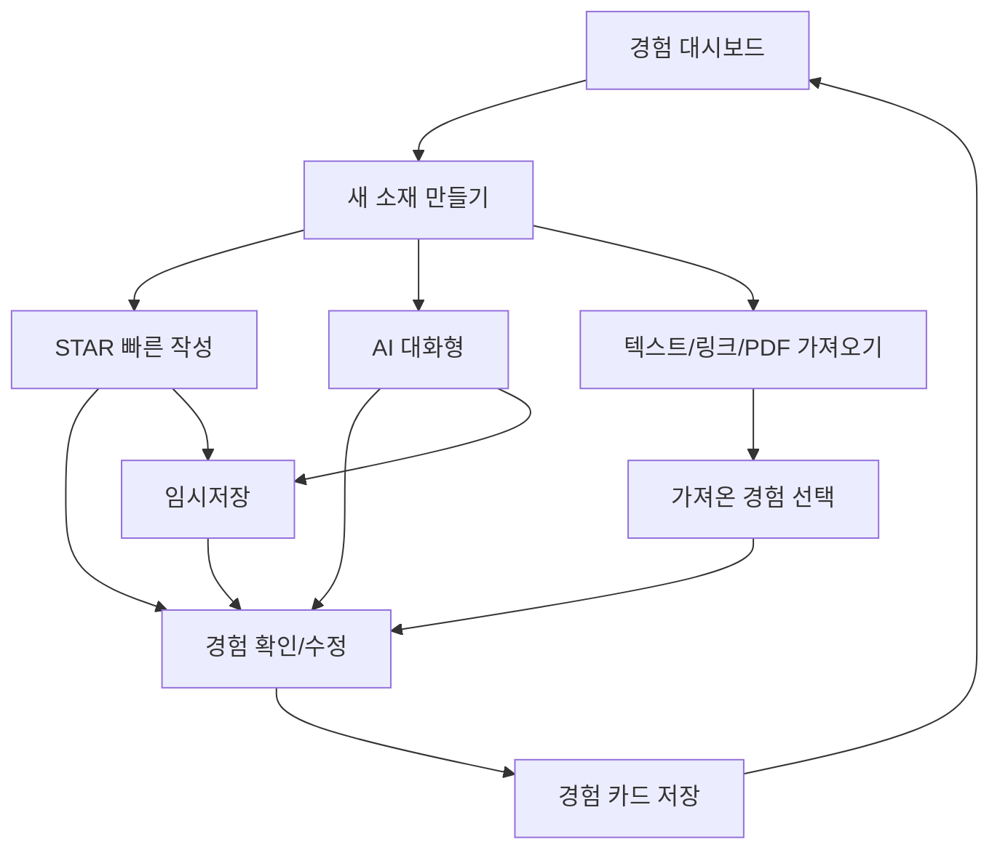

# 04. 경험 정리(Experience Management) 구현 계획

상태: **부분 구현**. `/experiences` 대시보드와 `/experiences/new` 기본 작성 방식 선택 UI가 현재 코드에 존재합니다. 서버 저장/STAR 작성/대화·가져오기는 미구현입니다.

### 원격 최신 코드 현황 (2026-11-01, `2a127df`)
- `src/app/experiences/page.tsx`: `TopPanels`/`Toolbar`/`ExperienceCard`를 조합한 대시보드 화면.
- `src/components/experiences/experiences-data.ts`: Figma 카드 배치용 정적 `EXPERIENCES` 데이터; 실제 사용자별 저장/검색 API 아님.
- `src/app/experiences/new/page.tsx` 및 `NewExperienceForm.tsx`: 제목·기간 입력, 태그 단일 선택, AI 대화/빠른 작성/가져오기 방법 선택 UI.
- `NewExperienceForm`은 태그와 작성 방법만 React state로 바꾸며 **다음 단계 버튼에는 실제 동작/저장 로직이 없음**.
- 구현 후속 우선순위: 검색/필터 동작, 다음 단계 라우팅, STAR 본문 편집, 저장·임시저장, 카드 상세/수정, AI/업로드.

## Figma 디자인
- [경험 정리 데스크톱 전체](https://www.figma.com/design/0wZM1igoWTo0vJt4Ncqpgl/Pofit-%ED%8F%AC%ED%95%8F?node-id=1-48599)
- [경험 정리 컴팩트 전체](https://www.figma.com/design/0wZM1igoWTo0vJt4Ncqpgl/Pofit-%ED%8F%AC%ED%95%8F?node-id=1-55094)

| 상태/화면 | Figma 노드 | 구현 포인트 |
| --- | --- | --- |
| 대시보드 기본 | [`1:48604`](https://www.figma.com/design/0wZM1igoWTo0vJt4Ncqpgl/Pofit-%ED%8F%AC%ED%95%8F?node-id=1-48604) | 카드 목록, 진입 CTA |
| 컴팩트 대시보드 | [`1:55099`](https://www.figma.com/design/0wZM1igoWTo0vJt4Ncqpgl/Pofit-%ED%8F%AC%ED%95%8F?node-id=1-55099) | 1023 반응형 |
| 필터 / 검색 결과 없음 | [`1:49004`](https://www.figma.com/design/0wZM1igoWTo0vJt4Ncqpgl/Pofit-%ED%8F%AC%ED%95%8F?node-id=1-49004) / [`1:49416`](https://www.figma.com/design/0wZM1igoWTo0vJt4Ncqpgl/Pofit-%ED%8F%AC%ED%95%8F?node-id=1-49416) | 태그 선택·검색·EmptyState |
| 새 소재 만들기 | [`1:50842`](https://www.figma.com/design/0wZM1igoWTo0vJt4Ncqpgl/Pofit-%ED%8F%AC%ED%95%8F?node-id=1-50842) | 작성 방식 선택 |
| 빠르게 작성하기(STAR) | [`1:49931`](https://www.figma.com/design/0wZM1igoWTo0vJt4Ncqpgl/Pofit-%ED%8F%AC%ED%95%8F?node-id=1-49931) | 유형별 질문·입력 |
| AI 대화형 경험정리 | [`1:49643`](https://www.figma.com/design/0wZM1igoWTo0vJt4Ncqpgl/Pofit-%ED%8F%AC%ED%95%8F?node-id=1-49643) | 대화 스레드, 답변 작성 |
| AI 대화 추가 질문 | [`1:50715`](https://www.figma.com/design/0wZM1igoWTo0vJt4Ncqpgl/Pofit-%ED%8F%AC%ED%95%8F?node-id=1-50715) | 후속 대화 |
| 가져오기 시작 / URL 입력 | [`1:48806`](https://www.figma.com/design/0wZM1igoWTo0vJt4Ncqpgl/Pofit-%ED%8F%AC%ED%95%8F?node-id=1-48806) / [`1:48842`](https://www.figma.com/design/0wZM1igoWTo0vJt4Ncqpgl/Pofit-%ED%8F%AC%ED%95%8F?node-id=1-48842) | 링크·첨부 |
| 링크 실패 / 용량 초과 | [`1:48878`](https://www.figma.com/design/0wZM1igoWTo0vJt4Ncqpgl/Pofit-%ED%8F%AC%ED%95%8F?node-id=1-48878) / [`1:48968`](https://www.figma.com/design/0wZM1igoWTo0vJt4Ncqpgl/Pofit-%ED%8F%AC%ED%95%8F?node-id=1-48968) | 오류·다시 업로드 |
| 가져온 경험 선택 | [`1:50477`](https://www.figma.com/design/0wZM1igoWTo0vJt4Ncqpgl/Pofit-%ED%8F%AC%ED%95%8F?node-id=1-50477) | 후보 선택 |
| 임시저장 / 이탈 경고 | [`1:50638`](https://www.figma.com/design/0wZM1igoWTo0vJt4Ncqpgl/Pofit-%ED%8F%AC%ED%95%8F?node-id=1-50638) / [`1:49686`](https://www.figma.com/design/0wZM1igoWTo0vJt4Ncqpgl/Pofit-%ED%8F%AC%ED%95%8F?node-id=1-49686) | 변경사항 보존 |
| 카드 확인 / 상세 / 수정 | [`1:49756`](https://www.figma.com/design/0wZM1igoWTo0vJt4Ncqpgl/Pofit-%ED%8F%AC%ED%95%8F?node-id=1-49756) / [`1:49856`](https://www.figma.com/design/0wZM1igoWTo0vJt4Ncqpgl/Pofit-%ED%8F%AC%ED%95%8F?node-id=1-49856) / [`1:49781`](https://www.figma.com/design/0wZM1igoWTo0vJt4Ncqpgl/Pofit-%ED%8F%AC%ED%95%8F?node-id=1-49781) | 상세·최종 수정 |

## 목표 사용자 흐름

## 화면/컴포넌트 분해 (제안)
- `/experiences`: `ExperienceDashboard`, `ExperienceCard`, `ExperienceSearch`, `ExperienceFilter`, `EmptyState`.
- `/experiences/new`: `InputMethodSelector`, `ExperienceCategoryPicker`, `STARForm`, `ConversationWorkspace`, `ImportDialog`.
- `/experiences/[id]`: `ExperienceDetail`, `ExperienceEditor`, `SaveStatus`, `ConfirmLeaveDialog`.
- 공통 상태: `draft`, `saved`, `loading`, `error`, `empty`, `unsavedChanges`.
- 서버/프론트 역할: 사용자 경험 데이터 저장/조회는 서버, 임시 UI state/입력 검증은 클라이언트, AI/파일 분석은 서버 API.

## 작성 유형과 데이터 설계 (제안)
| 유형 | 입력 | 결과 |
| --- | --- | --- |
| STAR | 상황(S), 과제(T), 행동(A), 결과(R), 경험 태그 | 제목/요약/핵심 역량 |
| AI 대화 | 사용자가 선택한 경험 태그, 질문/답변 히스토리 | 요약/정리본, 후속 질문 |
| 가져오기 | PDF/텍스트/링크, 출처 메타데이터 | 추출된 경험 후보 → 사용자 확인 |

- 경험 태그 후보: 성장 과정과 가치관, 성격 장단점, 학업/직무 관련, 대인관계/협업, 도전/극복. **IA 기반 가정**이며 실제 DB enum은 합의 필요.
- `Experience` 필드 초안: `id`, `ownerId`, `title`, `category`, `sourceType`, `star`, `summary`, `competencies[]`, `status`, `createdAt`, `updatedAt`.
- 드래프트에만 있는 대화 내용/첨부 임시 식별자는 확정 전 서버·클라이언트 분리 협의.
- API 계약 초안: `listExperiences(filters)`, `createExperience(input)`, `getExperience(id)`, `updateExperience(id)`, `deleteExperience(id)`, `saveDraft(input)`.
- AI/가져오기 계약 초안: `startConversation(tag)`, `appendMessage(sessionId,text)`, `extractExperiences(source)`, `confirmImportedExperience(selection)`.
- 목록 검색/정렬은 데이터가 많아질 경우 서버 pagination을 도입하며 URL 쿼리로 필터 상태를 재현할지 결정.

## 상태별 상호작용/예외
| 상황 | 예상 동작 | 수용 기준 |
| --- | --- | --- |
| 최초 데이터 없음 | 카드 대신 안내+새 경험 CTA | 사용자에게 시작 액션 표시 |
| 검색 결과 없음 | 검색어·필터 표시, 초기화 액션 | 검색 종료시 원래 목록 복원 |
| 작성 중 페이지 이탈 | 저장/버리기/계속 작성 선택 | 의도치 않은 데이터 소실 없음 |
| STAR 입력 부족 | 필수 필드별 helper/error | 임의 저장 정책과 제출 정책 분리 |
| AI 응답 실패 | 이전 답변 유지, 재시도 | 메시지 중복/유실 없음 |
| 분석중 | progress/loading 상태 | 중복 업로드 차단 |
| 잘못된 링크 | 인식 불가 및 재입력 | 입력값 유지 |
| 파일 크기 초과 | 제한 사유·재선택 | 서버·클라이언트 기준 일치 |
| 카드 수정 중 동시 변경 | 최신 데이터 버전 검사 | 마지막 저장 덮어쓰기 방지 |

## 구현 순서/선행 작업
- [ ] 공통 카드·Tag·Search·Dialog·Textarea 준비 ([디자인 시스템](./01-DESIGN-SYSTEM.md))
- [ ] 경험 목록/검색/필터/빈 상태를 목 데이터로 렌더링
- [ ] `Experience`/`ExperienceDraft` 타입과 입력 폼 스키마 확정
- [ ] `STARForm` 작성·임시저장·상세 수정·삭제의 CRUD 동선 구현 (**P0**)
- [ ] 작성 방법 선택 화면/태그별 안내 문구 및 최종 확인 구현
- [ ] Figma 각 프레임과 UI 상태 비교 (1440, 1023, 720)
- [ ] AI 대화형 인터페이스, 스트리밍 여부·오류/재시도 (**P1**, API 협의)
- [ ] 자료 업로드/링크 추출 흐름, progress/실패/보안 (**P1**)
- [ ] 저장 데이터와 자소서 문항 연결을 위한 경험 카드 선택 API
- [ ] 접근성, 비동기 race, 입력 장문/줄바꿈, 저장 중 이탈 E2E 검증

## 테스트 체크리스트
- [ ] EXP-01: 카드 없는 계정이 새 소재로 진입할 수 있음.
- [ ] EXP-02: STAR 작성 후 저장하면 목록에 표시되고 상세에서 수정 가능.
- [ ] EXP-03: 카테고리 다중 필터와 키워드 검색, 결과 없음/초기화 정상.
- [ ] EXP-04: 미저장 변경 후 뒤로가기/닫기는 경고·보존 정책에 따름.
- [ ] EXP-05: 2번 저장 클릭해도 경험이 중복되지 않음.
- [ ] EXP-06: AI 실패/지연 중 이미 입력된 답변 보존·재시도 가능.
- [ ] EXP-07: 파일 형식/용량/링크 오류 안내가 사용자에게 명확함.
- [ ] EXP-08: 컴팩트에서 사이드패널/카드가 겹치거나 가려지지 않음.

## 완료 조건
- [ ] **P0** 목록 → 새 경험 → STAR → 저장 → 상세 → 수정/삭제가 동작.
- [ ] 예외/임시저장/검색·필터 상태가 Figma와 일치.
- [ ] P1의 AI/첨부 기능은 실제 연동 여부를 UI와 문서에 구분.
- [ ] API/권한·검증·로그아웃 후 데이터 노출 방지 확인.
- [ ] lint/typecheck/build, 키보드, 1440/1023/720 시각 비교 완료.

## 아직 정할 것
- STAR 외 태그별 동적 폼, 자료 인식의 정확한 API 지원 형식·업로드 한도.
- 경험의 상태(draft/published), 버전 관리/편집 충돌 정책.
- 대화 세션 보존기간, 생성된 텍스트의 개인정보 및 사용자 통제 정책.
