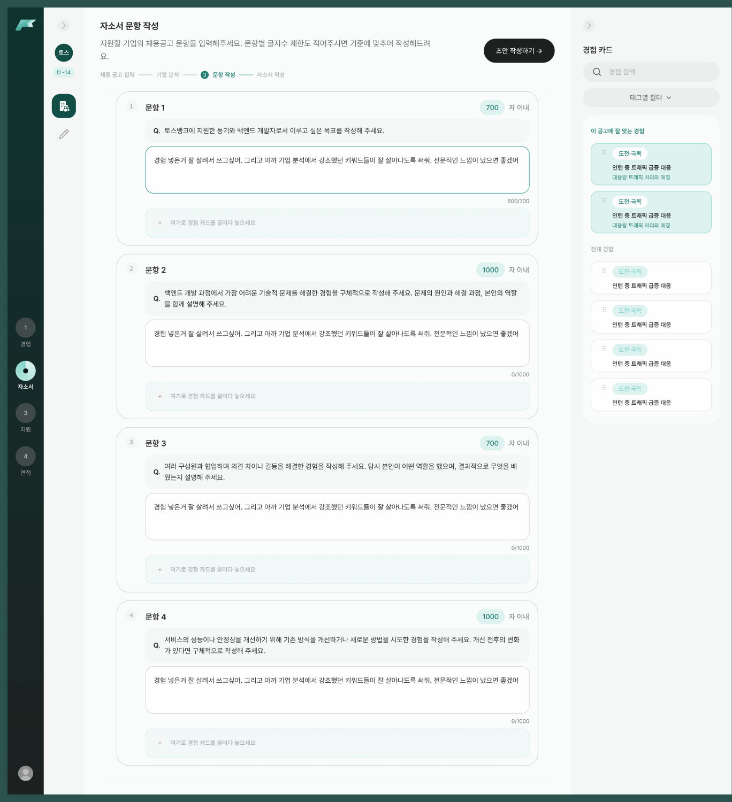
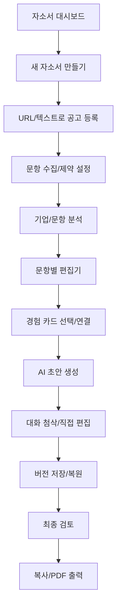

# 05. 자기소개서(자소서 관리·작성·첨삭) 구현 계획

상태: **부분 구현**. `/cover-letters/new`의 **채용공고 등록 첫 화면**은 구현되어 있고, 자소서 대시보드·문항 편집·서버 저장/AI 첨삭은 아직 구현 전입니다.

### 원격 최신 코드 현황 (2026-11-01, `2a127df`)
- `src/app/cover-letters/new/page.tsx` + `src/components/cover-letters/NewCoverLetterForm.tsx`: 기업명·직무명·마감일 입력, 링크/텍스트 탭 선택 화면.
- 탭 변경은 `useState("link" | "text")`로 작동하며, 제출 버튼/분석 실행/다음 단계는 **아직 실제 검증·API 연결이 없는 UI**입니다.
- 제목/기업/직무/URL 입력값은 폼 스키마나 저장 모델로 아직 묶이지 않았습니다.
- `/cover-letters` 목록과 `/cover-letters/[id]` 편집기는 구현되지 않았습니다.
- 우선순위: 폼 상태/검증 → 공고 등록/실패 처리 → 문항 생성 → 경험 카드 연결 → 첨삭/버전 관리.

## Figma 디자인과 미리보기
- [자기소개서 데스크톱 섹션](https://www.figma.com/design/0wZM1igoWTo0vJt4Ncqpgl/Pofit-%ED%8F%AC%ED%95%8F?node-id=1-51347)
- [자기소개서 컴팩트 섹션](https://www.figma.com/design/0wZM1igoWTo0vJt4Ncqpgl/Pofit-%ED%8F%AC%ED%95%8F?node-id=1-57395)

| 화면/상태 | Figma 참조 | 포인트 |
| --- | --- | --- |
| 자소서 대시보드 | [`1:53121`](https://www.figma.com/design/0wZM1igoWTo0vJt4Ncqpgl/Pofit-%ED%8F%AC%ED%95%8F?node-id=1-53121) | 기업별 목록/신규 만들기 |
| 공고 링크 붙여넣기 | [`1:51348`](https://www.figma.com/design/0wZM1igoWTo0vJt4Ncqpgl/Pofit-%ED%8F%AC%ED%95%8F?node-id=1-51348) | 기업/직무/URL 입력 |
| 링크 인식 완료/실패 | [`1:51753`](https://www.figma.com/design/0wZM1igoWTo0vJt4Ncqpgl/Pofit-%ED%8F%AC%ED%95%8F?node-id=1-51753) / [`1:51798`](https://www.figma.com/design/0wZM1igoWTo0vJt4Ncqpgl/Pofit-%ED%8F%AC%ED%95%8F?node-id=1-51798) | 로딩·실패·재시도 |
| 공고 텍스트 붙여넣기 | [`1:51392`](https://www.figma.com/design/0wZM1igoWTo0vJt4Ncqpgl/Pofit-%ED%8F%AC%ED%95%8F?node-id=1-51392) | 원문 등록 |
| 텍스트 분석 불가 | [`1:51619`](https://www.figma.com/design/0wZM1igoWTo0vJt4Ncqpgl/Pofit-%ED%8F%AC%ED%95%8F?node-id=1-51619) | 입력/분석 예외 |
| 기업 분석 리포트 | [`1:51941`](https://www.figma.com/design/0wZM1igoWTo0vJt4Ncqpgl/Pofit-%ED%8F%AC%ED%95%8F?node-id=1-51941) | 분석 결과 패널 |
| 문항 분석 | [`1:52114`](https://www.figma.com/design/0wZM1igoWTo0vJt4Ncqpgl/Pofit-%ED%8F%AC%ED%95%8F?node-id=1-52114) | 질문/역량/가이드 |
| 자소서 문항 답하기 | [`1:52178`](https://www.figma.com/design/0wZM1igoWTo0vJt4Ncqpgl/Pofit-%ED%8F%AC%ED%95%8F?node-id=1-52178) | 문항별 본문 |
| 초안 생성 | [`1:52210`](https://www.figma.com/design/0wZM1igoWTo0vJt4Ncqpgl/Pofit-%ED%8F%AC%ED%95%8F?node-id=1-52210) | 경험 연결·AI 생성 |
| 대화형 첨삭 | [`1:52307`](https://www.figma.com/design/0wZM1igoWTo0vJt4Ncqpgl/Pofit-%ED%8F%AC%ED%95%8F?node-id=1-52307) | AI 채팅 패널 |
| 버전 관리/저장 | [`1:52371`](https://www.figma.com/design/0wZM1igoWTo0vJt4Ncqpgl/Pofit-%ED%8F%AC%ED%95%8F?node-id=1-52371) / [`1:52489`](https://www.figma.com/design/0wZM1igoWTo0vJt4Ncqpgl/Pofit-%ED%8F%AC%ED%95%8F?node-id=1-52489) | 초안·수정본 보존 |
| 버전으로 저장 | [`1:52543`](https://www.figma.com/design/0wZM1igoWTo0vJt4Ncqpgl/Pofit-%ED%8F%AC%ED%95%8F?node-id=1-52543) | 명시적 새 버전 |
| 경험 태그 필터·검색/없음 | [`1:52854`](https://www.figma.com/design/0wZM1igoWTo0vJt4Ncqpgl/Pofit-%ED%8F%AC%ED%95%8F?node-id=1-52854) / [`1:52950`](https://www.figma.com/design/0wZM1igoWTo0vJt4Ncqpgl/Pofit-%ED%8F%AC%ED%95%8F?node-id=1-52950) / [`1:52982`](https://www.figma.com/design/0wZM1igoWTo0vJt4Ncqpgl/Pofit-%ED%8F%AC%ED%95%8F?node-id=1-52982) | 경험 탐색 |
| 최종 검토·복사·PDF | [`1:51974`](https://www.figma.com/design/0wZM1igoWTo0vJt4Ncqpgl/Pofit-%ED%8F%AC%ED%95%8F?node-id=1-51974) / [`1:52052`](https://www.figma.com/design/0wZM1igoWTo0vJt4Ncqpgl/Pofit-%ED%8F%AC%ED%95%8F?node-id=1-52052) / [`1:52013`](https://www.figma.com/design/0wZM1igoWTo0vJt4Ncqpgl/Pofit-%ED%8F%AC%ED%95%8F?node-id=1-52013) | 출력/마무리 |

## 사용자 흐름

## URL 및 프론트 구성 (제안)
- `/cover-letters`: `CoverLetterDashboard`, `CompanyFolder`, `CoverLetterItem`, `EmptyState`.
- `/cover-letters/new`: `PostingInputWizard`, `JobPostingPreview`, `QuestionSetupForm`.
- `/cover-letters/[id]`: `CoverLetterWorkspace`를 기본으로 상단 공고 요약, 중앙 문항 에디터, 우측 분석/AI 보조 패널.
- 하위 UI: `QuestionEditor`, `CharacterCounter`, `ExperiencePicker`, `ExperienceDropTarget`, `AnalysisPanel`, `AIChatPanel`, `VersionHistory`, `ExportDialog`.
- 반응형: 1440에서는 다중 패널, 1023~720에서는 패널의 탭/드로어 전환을 검토. 정확한 배치 순서는 Figma 컴팩트 프레임 확인.
- 입력 장문·다문항 시 에디터 헤더/sticky 툴바와 스크롤 영역 충돌 방지.

## 핵심 데이터 모델/계약 초안 (서버 확정 전)
| 모델 | 필드 초안 | 고려 사항 |
| --- | --- | --- |
| `CoverLetter` | id, userId, companyName, roleName, deadline?, postingId?, questions[], updatedAt | 기업·직무별 묶기 |
| `JobPosting` | id, sourceUrl?, rawText?, company, role, requirements[], preferredQualifications[], recruitmentSteps[] | 출처·신뢰도·최신성 |
| `CoverLetterQuestion` | id, coverLetterId, order, prompt, charLimit?, latestVersionId | 문항 순서·글자수 |
| `DraftVersion` | id, questionId, content, origin(manual/ai), createdAt, parentVersionId?, metadata | immutable snapshot |
| `LinkedExperience` | questionId, experienceId, note?, position | 경험 삭제/수정 시 연결 정책 |
| `AIThread` | id, questionId, messages[], status | 대화 히스토리/권한 |

- 프론트의 글자수 계산은 **한글/공백/개행 포함 기준**을 실제 채용공고/서버와 합의하고 동일 알고리즘으로 처리.
- 이전 버전은 수정 가능한 현재 문서와 분리하고, 자동 저장과 **새 버전 생성**을 혼동하지 않게 UX 설계.
- 사용자가 편집한 텍스트가 AI 재생성/첨삭 실패로 덮이지 않도록 저장 직전 확인과 revision ID 기반 동시성 제어 고려.
- 링크 파싱 실패 시 URL 원본과 직접 입력 데이터를 보존; 채용공고 분석 결과는 자동 판정이 아니라 사용자 확인 가능한 참고자료.

## 주요 상호작용 및 예외
| 이벤트 | 상태/보이는 변화 | 실패 시 대응 |
| --- | --- | --- |
| 기업/직무/마감 입력 | 검증 후 다음 단계 | 필수 값/URL 형식/기한 오류 |
| 공고 URL 분석 | loading→preview→confirm | 접근 불가·분석 실패→원문 입력 |
| 문항 추가/순서 변경 | 문항별 입력/글자수 | 빈 문항·중복 순서 |
| 경험 연결 | 태그/검색, 선택 또는 DnD | 검색 결과 없음·연결 중단 |
| AI 초안 생성 | 준비/생성중/생성완료 | 시간초과·사용량 제한·재시도 |
| AI 대화 첨삭 | 채팅 내용 + 제안 반영 | 이전 원문/버전 유지 |
| 본문 편집 | dirty/saving/saved | 저장 실패 배너 + 재시도 |
| 버전 저장 | immutable snapshot 생성 | 중복 버전 생성 방지 |
| 버전 복원 | 복원 전 비교/확인 | 편집 내용 유실 보호 |
| 복사/PDF | success toast/파일 생성 | 클립보드 제한·글꼴 깨짐·재시도 |

## API 및 AI 인터페이스 제안
- `createCoverLetter`, `listCoverLetters`, `getCoverLetter`, `updateCoverLetter`, `deleteCoverLetter`.
- `analyzeJobPosting({url?,text?})`, `analyzeCompany(postingId)`, `analyzeQuestion(questionId)`.
- `listExperiencesForQuestion(filters)`, `linkExperience(questionId,experienceId)`.
- `generateDraft({questionId,experienceIds[],analysisVersion})`, `reviseDraft({versionId,instruction})`.
- `saveQuestionDraft`, `listVersions`, `saveVersion`, `restoreVersion`, `exportPdf`.
- 서버는 AI 요청의 인증/쿼터/민감정보 보존/비밀키를 담당. 실제 경로/응답 구조는 백엔드와 합의 후 확정.

## 구현 순서 및 우선순위
- [ ] 공통 에디터/문항 탭/패널과 [경험 카드 API](./04-EXPERIENCES.md) 선행
- [ ] 자소서 목록 + 기업별 그룹 + 새 자소서 만들기 (P0)
- [ ] 공고 URL/텍스트 입력, 수동 입력 대체, 필수 검증 (P0)
- [ ] 문항 생성/수정/삭제, 글자수 제한, 자동/수동 저장 구분 (P0)
- [ ] 경험 카드 검색·선택·문항 연결 (P0), 드래그 앤 드롭 및 대체 선택 방식 (P1)
- [ ] 버전 저장/조회/복원, 미저장 변경 경고 (P0)
- [ ] 기업/문항 분석 + AI 초안/대화 첨삭 (P1, 서버 API)
- [ ] 최종 검토/텍스트 복사/한글 PDF 출력 (P1)
- [ ] 1440/1023/720 UI 비교, 협업 에러·AI 지연·네트워크 장애 검증

## 테스트 기준
- [ ] CV-01: 기업/직무/문항 입력 후 작성 중인 자소서가 목록에 표시.
- [ ] CV-02: 파싱 실패 시 수동 입력 전환과 정보 보존.
- [ ] CV-03: 문항별 제한 초과 시 정확한 기준으로 경고·저장 정책 적용.
- [ ] CV-04: 경험 태그/검색 후 경험을 문항에 연결/해제 가능.
- [ ] CV-05: AI 요청 취소/실패 뒤 현재 본문이 사라지지 않음.
- [ ] CV-06: 버전 A→B 생성, 이전 버전 조회/복원 시 데이터 보존.
- [ ] CV-07: 복사/PDF의 텍스트 내용·줄바꿈·한글 폰트가 정상.
- [ ] CV-08: 컴팩트에서 에디터와 AI 패널이 가려지지 않음.
- [ ] CV-09: 다른 사용자 문서는 ID를 알아도 조회되지 않음.

## 완료 조건과 미확정
- [ ] P0: 기업/문항 CRUD + 경험 링크 + 버전 저장/복원 완료.
- [ ] P1: 실제 AI/JD 분석·첨삭·내보내기는 서버 계약/비용/보안 검토 후 완료.
- [ ] 모든 에러/빈 상태/반응형/접근성 및 lint/typecheck/build 통과.
- 미확정: 분석 공급자·정확도, 문항 글자수 정의, autosave 주기, PDF 서버/클라이언트 선택, 구인 URL 접근 정책.
