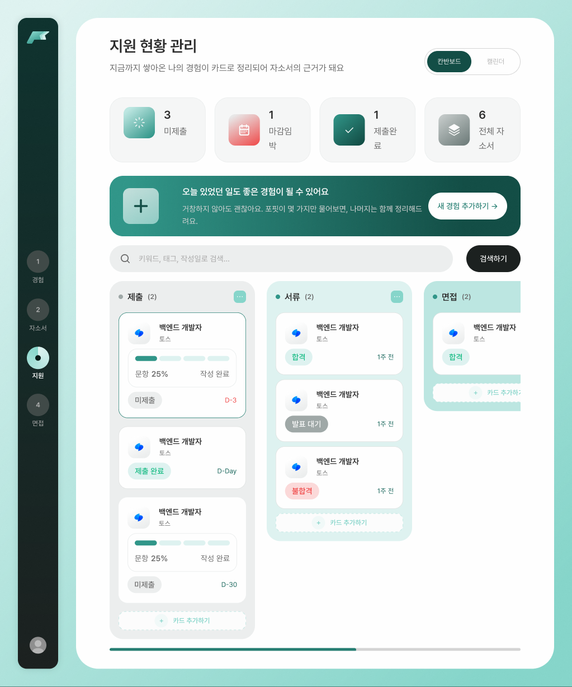
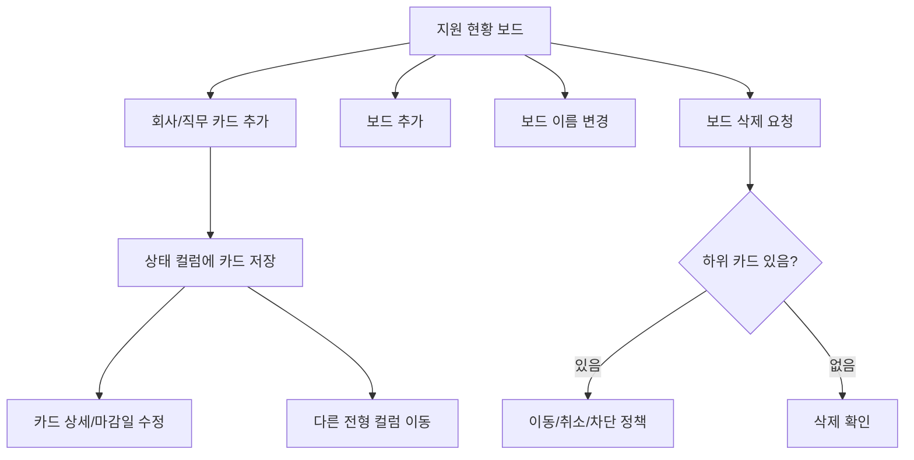

# 06. 지원 현황 관리(칸반 보드) 구현 계획

상태: **부분 구현**. `/applications`의 칸반 화면과 카드/통계/검색 입력 UI가 존재하지만 실제 카드·컬럼 CRUD/DnD·검색 기능은 미구현입니다.

### 원격 최신 코드 현황 (2026-11-01, `2a127df`)
- `src/app/applications/page.tsx` + `src/components/applications/ApplicationsBoard.tsx`: LNB, 통계, 배너, 검색 입력창, 칸반 컬럼/카드 렌더링.
- `src/components/applications/kanban-data.ts`: 제출·서류·면접·최종 단계의 **하드코딩된 `COLUMNS` 예시 데이터**.
- 검색 버튼/카드 추가/컬럼 추가/컬럼 메뉴는 현재 시각 UI이며 저장/검색/드래그 핸들러가 연결되지 않았습니다.
- 통계 숫자도 실제 API가 아닌 정적 값입니다. 자료 연동·클릭 상세/수정·마감 알림은 추후 구현합니다.
- 우선순위: 데이터 모델 정리 → 카드 CRUD/검색 → 컬럼 관리 → 실제 이동·저장 → DnD/키보드 대체.

## Figma 디자인
- [1440 지원관리 섹션](https://www.figma.com/design/0wZM1igoWTo0vJt4Ncqpgl/Pofit-%ED%8F%AC%ED%95%8F?node-id=1-53161)
- [1023 지원관리 섹션](https://www.figma.com/design/0wZM1igoWTo0vJt4Ncqpgl/Pofit-%ED%8F%AC%ED%95%8F?node-id=1-58837)

| Figma 프레임 | 링크 | 용도 |
| --- | --- | --- |
| 칸반 기본 1440 | [`1:53162`](https://www.figma.com/design/0wZM1igoWTo0vJt4Ncqpgl/Pofit-%ED%8F%AC%ED%95%8F?node-id=1-53162) | 컬럼과 카드 |
| 컴팩트 칸반 | [`1:58838`](https://www.figma.com/design/0wZM1igoWTo0vJt4Ncqpgl/Pofit-%ED%8F%AC%ED%95%8F?node-id=1-58838) | 좁은 화면 |
| 예외 처리 | [`1:53507`](https://www.figma.com/design/0wZM1igoWTo0vJt4Ncqpgl/Pofit-%ED%8F%AC%ED%95%8F?node-id=1-53507) | 실패/안내 |
| 보드 추가 | [`1:53740`](https://www.figma.com/design/0wZM1igoWTo0vJt4Ncqpgl/Pofit-%ED%8F%AC%ED%95%8F?node-id=1-53740) | 신규 컬럼 |
| 보드 삭제 | [`1:53838`](https://www.figma.com/design/0wZM1igoWTo0vJt4Ncqpgl/Pofit-%ED%8F%AC%ED%95%8F?node-id=1-53838) | 확인 모달 |
| 이름 변경 | [`1:53941`](https://www.figma.com/design/0wZM1igoWTo0vJt4Ncqpgl/Pofit-%ED%8F%AC%ED%95%8F?node-id=1-53941) | 인라인/모달 편집 |
| 컴팩트 추가/삭제/변경 | [`1:59411`](https://www.figma.com/design/0wZM1igoWTo0vJt4Ncqpgl/Pofit-%ED%8F%AC%ED%95%8F?node-id=1-59411) / [`1:59508`](https://www.figma.com/design/0wZM1igoWTo0vJt4Ncqpgl/Pofit-%ED%8F%AC%ED%95%8F?node-id=1-59508) / [`1:59610`](https://www.figma.com/design/0wZM1igoWTo0vJt4Ncqpgl/Pofit-%ED%8F%AC%ED%95%8F?node-id=1-59610) | 반응형 상태 |

## 화면 분해
- URL: `/applications`. 메인: `ApplicationBoard`, `ApplicationColumn`, `ApplicationCard`, `AddColumn`, `ColumnMenu`, `ApplicationDetailDrawer`.
- 카드 생성/편집: 회사명, 직무명, 마감일, 지원 상태, 전형 일정, 이력서/포트폴리오/과제 여부 등 (IA에 있는 **초안 스키마**).
- 기본 단계 제안: 작성 중 → 제출 완료 → 서류 전형 → 면접 전형 → 최종 결과. Figma의 컬럼 이름·세부 enum·사용자 지정 컬럼 정책은 개발 직전 확인.
- 카드 이동: DnD(드래그 앤 드롭) + 키보드/터치 대체용 "이동" 메뉴.
- 컬럼 관리: 추가·이름 변경·삭제 확인; 컬럼에 카드가 있을 때 마이그레이션 또는 삭제 차단 정책 필수.

## 사용자 플로우

## 프론트 상태·데이터 모델 제안
| 모델 | 필드 초안 | 메모 |
| --- | --- | --- |
| `ApplicationBoard` | id, ownerId, columns[], updatedAt | 사용자별 컬럼 구성 |
| `ApplicationColumn` | id, boardId, name, order, stageKey? | 정렬·이름 중복 검사 |
| `Application` | id, ownerId, columnId, company, role, deadline?, submittedAt?, currentStage?, notes? | 카드 핵심 데이터 |
| `RecruitmentEvent` | id, applicationId, type, date?, result? | 일정/결과 이력 |
| `ApplicationAttachment` | applicationId, kind, fileId?, status? | 이력서/포폴/과제 메타 |

- 필터/정렬(마감순, 업데이트순), 드래그 후 order 값 조정, 다중 사용자 권한 분리 필요.
- 서버에 column order와 card order의 정렬 기준을 명확히 저장; 낙관적 이동 후 실패 시 정확히 이전 상태로 복구.
- 자소서 문서가 존재하면 관련 `coverLetterId` 참조 여부를 백엔드와 결정 (반드시 생성하도록 강제하지 않음).
- 마감일/이벤트 날짜는 타임존을 포함한 ISO 문자열을 API 계약으로 정의. 브라우저 현지 타임존에서 표시.

## 상태별 UI 정책
| 상황 | 인터랙션 | 오류/대응 |
| --- | --- | --- |
| 빈 보드 | 최초 컬럼/카드 추가 CTA | 단계 템플릿 여부 정책 |
| 카드 신규 | 필수 기업명/직무 입력 후 저장 | 검증/중복 제출 차단 |
| 카드 클릭 | 상세 패널/모달 | 미존재 카드 안내 |
| 카드 드래그 | 이동 위치 프리뷰 → 서버 반영 | 실패 시 롤백 + Toast |
| 컬럼 추가 | 이름 입력/확인 | 중복/빈 문자열/최대 수 협의 |
| 컬럼 변경 | edit→save/cancel | 서버 충돌 시 재조회 |
| 컬럼 삭제 | 삭제 확인 | 카드 존재 시 처리 정책 |
| 컴팩트 | 컬럼 가로 스크롤/접힘/탭 중 결정 | 터치 스크롤/drag 충돌 방지 |
| 긴 이름·마감일 | 줄바꿈, 툴팁, locale 포맷 | 카드 높이/overflow 최소화 |

## API 계약 초안 (제안이며 서버 스펙 아님)
- `getApplicationBoard`, `createColumn`, `renameColumn`, `deleteColumn`, `reorderColumns`.
- `listApplications`, `createApplication`, `getApplication`, `updateApplication`, `deleteApplication`.
- `moveApplication({id,columnId,position,revision})`, `getRecruitmentEvents`, `saveRecruitmentEvent`.
- 선택 라이브러리 후보: `@dnd-kit/core`/sortable (실제 구현 시 도입하고 접근성 확인).
- 사용자 소유권, 컬럼 삭제 정책, 카드 이동 동시성/순서 충돌 등은 API 문서에서 명시.

## 구현 단계
- [ ] 공통 Card/Modal/Menu/Toast/EmptyState 준비
- [ ] Figma 1440/1023 프레임 구조 분석, 컬럼 폭·여백·색/유형 일치
- [ ] 정적/목 데이터로 보드, 컬럼, 카드 렌더링 (P0)
- [ ] 신규 카드·상세·수정·삭제 (P0)
- [ ] 컬럼 추가·이름 변경·삭제 예외 처리 (P0)
- [ ] 서버 연동 후 카드 CRUD·상태 저장·정렬 복원 (P0)
- [ ] DnD 및 실패 롤백, 키보드/터치 대체 이동 (P1)
- [ ] 지원 일정/첨부파일/알림 등 확장 기능 협의 (P1/P2)
- [ ] 1440/1023/720/360 가로 스크롤/drag/keyboard UX 검증

## 테스트 시나리오
- [ ] APP-01: 빈 보드에서 컬럼/카드 생성.
- [ ] APP-02: 카드 상태 변경 후 새로고침해도 상태 보존.
- [ ] APP-03: 드래그 후 API 실패 시 원래 순서/컬럼 복귀.
- [ ] APP-04: 컬럼 이름 중복/빈 문자열 오류 표시.
- [ ] APP-05: 카드 있는 컬럼 삭제 시 확인/이동 정책 적용.
- [ ] APP-06: 키보드와 터치만으로 카드 이동 가능.
- [ ] APP-07: 일정/마감일의 날짜·타임존/연말 경계가 정확.
- [ ] APP-08: 1023/720에서 카드 겹침·의도치 않은 가로 페이지 스크롤 없음.
- [ ] APP-09: 다른 계정의 지원 카드 및 첨부 정보 접근 불가.

## 완료 조건 / 미확정
- [ ] 칸반/카드/컬럼 기본 CRUD + 반응형 + 오류/빈 상태 구현.
- [ ] 상태 이동의 저장·충돌·실패 처리 및 접근성 검증.
- [ ] Figma 원본과 실제 렌더 스크린샷 비교 완료, lint/typecheck/build 통과.
- 미확정: 기본 컬럼 고정/커스텀 여부, 삭제 시 카드 처리, 최대 카드/컬럼 개수, 전형 일정 알림.
