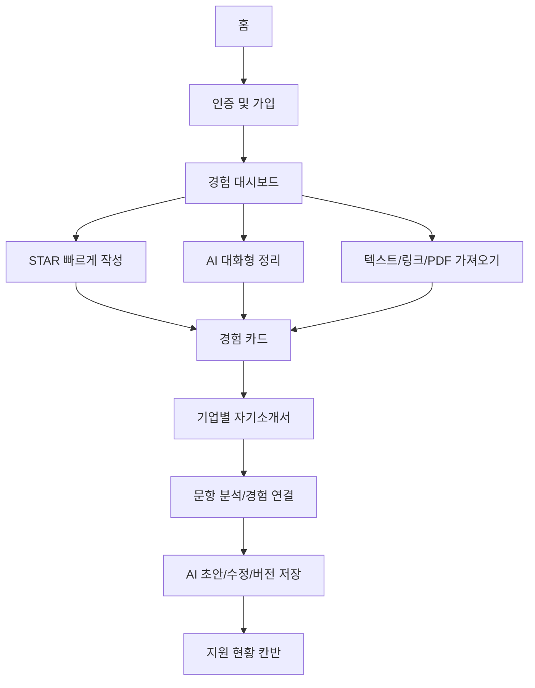

# POFIT — 화면별 구현 계획 문서

> 기준: [client-v2 저장소](https://github.com/2026-Hongik-Graduation/client-v2), [Figma POFIT 원본](https://www.figma.com/design/0wZM1igoWTo0vJt4Ncqpgl/Pofit-%ED%8F%AC%ED%95%8F?node-id=0-1), 2026-11-01.
> 현재 원격에는 홈, 로그인, 비밀번호 찾기 이메일 인증, 경험 대시보드·추가, 자소서 신규 입력 폼, 지원 칸반의 **일부 기본 UI**가 존재하며 CRUD/실제 인증/AI 등 나머지는 **구현 계획**입니다. 아래 이미지는 Figma MCP에서 추출한 시안 **미리보기**이지 실제 개발된 웹 화면이 아닙니다.

## 탐색
| 문서 | 범위 | 구현 기준 |
| --- | --- | --- |
| [01 — 디자인 시스템](./01-DESIGN-SYSTEM.md) | 토큰, 폰트, 그리드, 공통 컴포넌트, 에셋 | Figma 디자인 시스템 |
| [02 — 홈](./02-HOME.md) | 랜딩, CTA, 반응형, 스크롤 애니메이션 | **홈 코드는 현재 구현됨**, QA 필요 |
| [03 — 인증](./03-AUTH.md) | 로그인, 가입/인증, 비밀번호 찾기 | 로그인·비밀번호 찾기 1단계 UI 구현, 실제 인증 예정 |
| [04 — 경험 정리](./04-EXPERIENCES.md) | 대시보드, STAR, AI 대화, 가져오기 | 기본 대시보드/방식선택 UI 구현, 기능 예정 |
| [05 — 자기소개서](./05-COVER-LETTERS.md) | 공고/기업 분석, 문항, AI 초안·첨삭, 버전 | 신규 공고 입력 UI 구현, 분석·저장 예정 |
| [06 — 지원 현황](./06-APPLICATIONS.md) | 칸반, 카드, 컬럼 관리 | 목 데이터 칸반 UI 구현, 조작·저장 예정 |
| [07 — 통합/QA](./07-INTEGRATION-QA.md) | 공통 설계, API, 보안, 접근성, QA, 배포 | 구현 예정 |
| [면접 준비 P0](./INTERVIEWS-P0.md) | 면접 질문·타이머·답변 기록, 데이터 제한 | 2026-11-05 후속 로컬 브랜치 기능 구현 |
| [자소서 AI P1](./COVER-LETTER-AI-P1.md) | 문항 분석·전략·초안·첨삭·대화 기록 및 미리보기 | 2026-11-05 후속 로컬 브랜치, 실제 EC2 E2E 미검증 |
| [미리보기 출처](./figma-previews/README.md) | 추출한 Figma PNG ↔ 노드 매핑 | 참고 자료 |

## 서비스 흐름

## Figma 바로가기
- [1440px 디자인 전체 영역](https://www.figma.com/design/0wZM1igoWTo0vJt4Ncqpgl/Pofit-%ED%8F%AC%ED%95%8F?node-id=1-48161)
- [1023~720px 컴팩트 전체 영역](https://www.figma.com/design/0wZM1igoWTo0vJt4Ncqpgl/Pofit-%ED%8F%AC%ED%95%8F?node-id=1-54744)
- [디자인 시스템](https://www.figma.com/design/0wZM1igoWTo0vJt4Ncqpgl/Pofit-%ED%8F%AC%ED%95%8F?node-id=1-60404)
- [IA/기능 구상 페이지](https://www.figma.com/design/0wZM1igoWTo0vJt4Ncqpgl/Pofit-%ED%8F%AC%ED%95%8F?node-id=91-2)

## 문서 읽는 법
- **Figma 확인**: 실제 레이어/프레임 이름, 노드 및 시안에 근거한 항목.
- **제안**: API URL/DB 스키마, 상태 라이브러리, URL 설계 등 개발 팀과 합의해야 할 내용.
- **완료 조건**: 해당 기능이 코드·테스트·시각 검증에 반영되었을 때 체크할 항목.
- PNG 캡처는 Figma 원본을 보여주기 위한 것이며 코드 구현 때 화면 전체를 이미지로 붙이지 않습니다.
- Figma MCP가 호출 제한에 도달한 상태라 **전체 프레임의 캡처는 아직 확보되지 않았습니다.** 누락된 장면은 각 문서의 정확한 프레임 링크로 확인합니다.
- 모든 Markdown 문서는 프로젝트 구조와 백엔드 계약 변경 시 함께 갱신합니다.

## 기능 간 선행 관계
1. **디자인 시스템**(버튼/입력/모달/탭/카드) → 인증/경험/자소서/칸반 공통 사용.
2. **인증과 프로필** → 보호 라우트 및 사용자별 경험·자소서 데이터.
3. **경험 카드 데이터 계약** → 자기소개서 문항에 경험 연결.
4. **자소서/채용공고 모델** → 지원 관리 카드에서 관련 자소서·일정 참조.
5. **AI/파일 업로드** → 기본 CRUD가 동작한 다음 외부 서비스 연동.
6. **QA 및 보안**은 마지막 단계에 한 번이 아니라 각 기능마다 병행.
